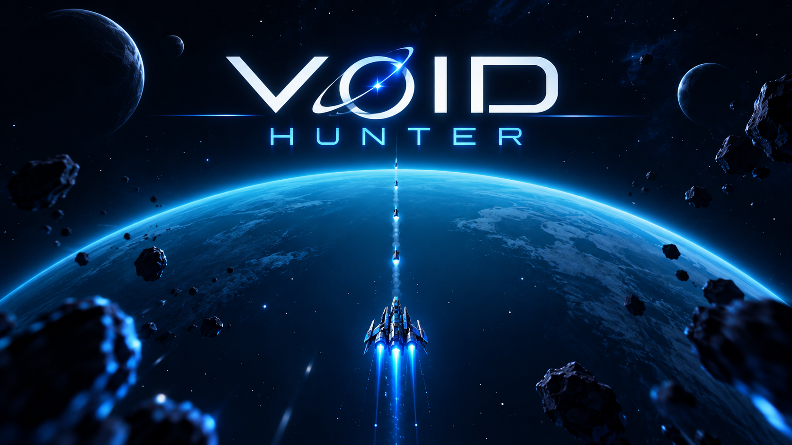

<p align="center"></p>

<h1 align="center">VOID HUNTER</h1>
<p align="center"><b>Enter the sector. Build your ship. Survive the void.</b><br /><sub>An action-packed space bullet-heaven roguelite by Stokeley.</sub></p>

<p align="center"><a href="#getting-started"><b>RUN LOCALLY</b></a> · <a href="#controls"><b>CONTROLS</b></a> · <a href="#telegram-bot-optional"><b>TELEGRAM BOT</b></a> · <a href="perks_analysis.md"><b>PERK ANALYSIS</b></a></p>

---

## Overview

**Void Hunter** is an action-packed space bullet-heaven roguelite shooter built with **React 19**, **TypeScript**, **Vite**, **HTML5 Canvas**, and **Tailwind CSS**, featuring full **Telegram Web App** support and **bilingual English/Russian localization**.

Take your ship into hostile sectors, survive relentless alien waves, and shape your build through deep upgrades, synergies, and weapon evolutions. Earn credits, customize your ship and rockets in the hangar, and push for a higher survival score.

---

## Features

- **Full Bilingual Localization (EN / RU)**:
  - Seamless in-game language toggle accessible from both the **Main Menu header** (`[🌐 RU/EN]`) and the **Settings Modal**.
  - All menus, HUD alerts, sector descriptions, ship/rocket skins, weapon tiers (Levels 1–5), passive modules, rocket mutations, evolutions, and canvas hazard warnings are localized with zero-latency switching and `localStorage` persistence.
- **Deep Upgrades & Evolution System**:
  - **10 Active Weapons**: Each with 5 upgrade tiers and a unique Legendary Evolution unlocked by pairing with matching passive modules.
  - **10 Passive Modules**: Stat-enhancing upgrades including neutron armor, haste reactors, vacuum fields, and multi-shot arrays.
  - **12 Rocket Mutations & 3 Legendary Synergies**: Transform secondary munitions into homing cluster warheads, orbital lasers, or cryo-rounds.
- **Galaxy Sectors & Cosmic Hazards**:
  - 4 sectors (Asteroid Belt, Nebula of Shadows, Void Sector, Cyber Core) with distinct wave archetypes, anomalies, and boss encounters.
  - Dynamic procedural canvas hazards: *Gravity Surges* and *Ion Storms*.
- **Hangar & Customization**:
  - Unlockable ship skins, animated rocket trails, stat badges, and secret passcode terminal.
- **Cross-Platform Responsive Controls**:
  - Desktop: Smooth `WASD` / Arrow keys navigation with tactical pause (`Esc` / `P`).
  - Mobile / Touch: Responsive on-screen virtual analog joystick and touch-friendly UI.
  - Telegram WebApp: Ready to play natively inside Telegram groups, channels, or direct messages.

---

## Getting Started

### Prerequisites

- **Node.js 20** or newer
- **npm** (included with Node.js)

### Installation & Development

1. Clone the repository:
   ```bash
   git clone https://github.com/Skimask1448/VoidHunterUz.git
   cd VoidHunterUz
   ```
2. Install dependencies:
   ```bash
   npm ci
   ```
3. Start the Vite local development server:
   ```bash
   npm run dev
   ```
   Open [http://localhost:3000](http://localhost:3000) in your browser.

> On Windows, you can also double-click `START_GAME.bat` to launch the dev server and open the game in your browser with a single click.

### Production Build & Linting

```bash
# Typecheck with TypeScript
npm run lint

# Build optimized production bundle to dist/
npm run build

# Preview production build locally
npm run preview
```

---

## Controls

| Platform | Action | Key / Input |
|---|---|---|
| **PC / Desktop** | Move Ship | `W`, `A`, `S`, `D` or `Arrow Keys` |
| **PC / Desktop** | Tactical Pause | `Esc` or `P` |
| **Mobile / Touch** | Move Ship | On-screen virtual analog joystick |
| **Mobile / Touch** | Tactical Pause | Pause button in the top HUD |

---

## Telegram Bot (Optional)

A companion Python Telegram bot is included in `bot.py` to launch the game inside Telegram Web App and maintain a persistent leaderboard.

### Bot Setup

1. Install Python 3.10+ and the `pyTelegramBotAPI` library:
   ```bash
   pip install pyTelegramBotAPI
   ```
2. Configure environment variables (or copy `.env.example` to `.env`):
   - `BOT_TOKEN`: Your Telegram Bot token from [@BotFather](https://t.me/BotFather).
   - `GAME_SHORT_NAME`: Registered Telegram Game short name (e.g. `voidhunter`).
   - `GAME_URL`: Public HTTPS deployment URL of your game (e.g. `https://skimask1448.github.io/VoidHunterUz/`).
   - `LEADERBOARD_FILE`: Optional JSON file path for records (default: `leaderboard.json`).

3. Run the bot:
   - **Windows**: Run `start_bot.bat` (includes auto-restart and crash prevention) or execute:
     ```powershell
     $env:BOT_TOKEN = "your_telegram_bot_token"
     python bot.py
     ```
   - **Linux / macOS**:
     ```bash
     export BOT_TOKEN="your_telegram_bot_token"
     python bot.py
     ```

> **Security Note:** Results sent from client-side games are validated for format and range limits, but cannot be cryptographically proven without server-authoritative simulation. Do not attach monetary or scarce rewards solely to client-reported scores.

---

## Architecture & Upgrades Reference

- **Perks & Synergies Analysis**: Detailed damage formulas, balance tier lists, and evolution mechanics are documented in [`perks_analysis.md`](perks_analysis.md).
- **Localization Architecture**: Types, dictionaries, and provider reside in [`src/i18n/`](src/i18n/).

---

## License

MIT License. See project files for details.
